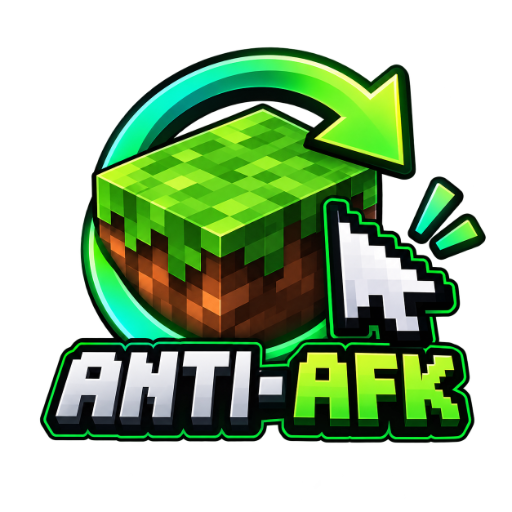

<div align="center">
  

  <h1>Anti-AFK</h1>
  <p><strong>Твой Minecraft. Твои правила активности.</strong></p>
  <p>Лёгкое приложение для Windows, которое помогает управлять активностью в Minecraft Java и Bedrock.</p>

  <p>
    <a href="https://github.com/givekoll-sketch/Anti-AFK/releases/latest"></a>
    <a href="https://github.com/givekoll-sketch/Anti-AFK/actions/workflows/release.yml"></a>
    <a href="https://github.com/givekoll-sketch/Anti-AFK/releases"></a>
  </p>

  <p><a href="https://github.com/givekoll-sketch/Anti-AFK/releases/latest"><strong>↓ Скачать для Windows</strong></a> &nbsp;·&nbsp; <a href="#возможности">Возможности</a> &nbsp;·&nbsp; <a href="#быстрый-старт">Быстрый старт</a> &nbsp;·&nbsp; <a href="#обновления">Обновления</a></p>
  <p><sub>Windows 10/11 · x64 · Minecraft Java &amp; Bedrock</sub></p>
</div>

---

## Возможности

| | |
|:--|:--|
| **Java и Bedrock** | Поиск открытых окон Minecraft и выбор нужного клиента |
| **Настраиваемые действия** | Поворот камеры, прыжок и движение вперёд |
| **Гибкий интервал** | Секунды, минуты или часы; минимум — 5 секунд |
| **Горячие клавиши** | Запуск, остановка и пауза, даже когда приложение свёрнуто |
| **Журнал действий** | Локальная запись событий и ошибок для диагностики |
| **Персонализация** | Восемь языков, светлая/тёмная тема, четыре стиля и управление анимацией |
| **Таймер-оверлей** | Прозрачный таймер поверх игры; его можно перетаскивать |
| **Маркет плагинов** | Просмотр, установка, включение, отключение и удаление дополнений |
| **Обновления** | Проверка при запуске и установка новой версии из приложения |

> Первое действие выполняется сразу после запуска. Ввод выполняется через Windows `SendInput` только когда выбранное окно Minecraft активно; при потере фокуса приложение повторяет попытку автоматически.

## Скачать и установить

1. Откройте **[последний релиз](https://github.com/givekoll-sketch/Anti-AFK/releases/latest)**.
2. Скачайте `Anti-AFK-Setup-<версия>.exe` из раздела **Assets**.
3. Запустите установщик и следуйте инструкциям.

Для установленной версии не нужны Node.js или дополнительные библиотеки. Поддерживается Windows 10/11 x64.

## Быстрый старт

1. Запустите Anti-AFK и Minecraft.
2. Найдите окно игры на главной странице и выберите нужные действия.
3. Установите интервал и нажмите **«Запустить»**.
4. Переместите появившийся таймер-оверлей в удобное место. При необходимости приостановите или остановите работу кнопками приложения.

| Клавиша | Действие |
|:--:|:--|
| `F6` | Запустить сохранённую конфигурацию |
| `F7` | Остановить |
| `F8` | Пауза / продолжить |

## Обновления

При запуске приложение проверяет GitHub Releases. Если доступна новая версия, появится уведомление с кнопками **«Установить»** и **«Отменить»**. При отказе можно подтвердить свой выбор и включить опцию, чтобы больше не показывать предупреждение об отказе.

В релизах Anti-AFK публикуются установщик и файл `latest.yml`. Этот небольшой манифест **нужен** `electron-updater`: по нему приложение узнаёт номер версии, ссылку на установщик и его контрольную сумму. Файл `.blockmap` используется только для дифференциальной загрузки частей установщика. В Anti-AFK она отключена, поэтому blockmap не требуется и не публикуется — обновление скачивает установщик целиком.

### Предупреждение Windows

Установщик пока не подписан сертификатом издателя, поэтому Windows может показать SmartScreen. Не устанавливайте приложение, если не доверяете источнику загрузки.

## Настройки и плагины

Доступны русский, английский, испанский, португальский, корейский, японский, китайский и польский языки, стили Minecraft/OLED/Незер/Энд и переключатель анимаций. Настройки применяются сразу и требуют подтверждения.

Маркет загружает официальный JSON-каталог Anti-AFK. Плагины являются декларативными пакетами: они могут добавлять только встроенные безопасные действия камеры, прыжка и ходьбы; исполняемый сторонний код не запускается. Установленные дополнения можно включить, выключить или удалить во вкладке **«Мои плагины»**.

Следите за новостями в [нашем Telegram-канале](https://t.me/+bhbJN3fL9NQxZGIy).

## Для разработчиков

### Запуск из исходного кода

Нужны Node.js 20 или новее и npm:

```bash
npm ci
npm run dev
```

Сборка Windows-установщика:

```bash
npm run dist
```

Готовый установщик появится в `release/`.

### Публикация релиза

Workflow `.github/workflows/release.yml` запускается для тега вида `v*`. Перед публикацией обновите версию в `package.json` и `package-lock.json`, подготовьте `RELEASE_NOTES.md` и отправьте тег, например `v1.0.5`. Используйте стандартные версии SemVer из трёх числовых частей: четырёхчастные варианты вроде `1.0.2.1` несовместимы со сравнением версий автообновлятором. К релизу прикрепляются только установщик и обязательный `latest.yml`; blockmap не загружается.

## Важные замечания

- Проверьте правила сервера перед использованием: некоторые серверы запрещают автоматизацию.
- Не сворачивайте выбранное окно Minecraft: действия выполняются только при фокусе игры.
- Если Minecraft запущен от имени администратора, запустите Anti-AFK с теми же правами.
- Названия окон и процессов могут различаться в зависимости от лаунчера и сборки игры.
- Если игра игнорирует ввод, проверьте настройки управления и права запуска игры и Anti-AFK.

## Иконки

Исходные изображения приложения находятся в [`assets/`](assets/): `icon.png` используется для Windows-иконки `icon.ico`, `logo.png` — на странице проекта и в разделе «О программе», `logo-small.png` — в интерфейсе, `tray.png` подготовлен для значка системного трея.

## Сообщить о проблеме

Создайте [issue](https://github.com/givekoll-sketch/Anti-AFK/issues) с описанием проблемы или посмотрите [список релизов](https://github.com/givekoll-sketch/Anti-AFK/releases).
